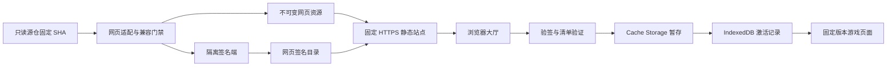

# 跨平台网页版游戏大厅设计

- 文档版本：0.3，2026-10-17（Asia/Shanghai）。
- 文档状态：VERIFIED，仅表示开工文档检查与提交后独立复审通过；产品开发状态：PENDING。
- 授权范围：2026-10-17用户要求审核设计、准备启动开发。本轮完善设计、需求/用例、实施计划和审阅记录；不实现产品或部署公网。
- 依据：现有 Android 大厅 v0.4.1、v1/v2 资源协议、[自动检查与发行策略](自动检查与发行策略.md)、[存档兼容规范](存档格式与升级兼容规范.md)。设计参考提交：f2c181cfd66ef9c222b2152b75f02bb21457dbb3；实施时重新冻结源提交和完整工作树状态，不移动原基线。
- 审阅与批改：[设计自审记录](跨平台网页版游戏大厅自审.md)，历史R01–R06及本轮R07–R15已关闭，f239bf8/cbbd1be提交后独立复审CLOSED；[需求与测试用例](网页版大厅需求与测试用例.md)、[实施计划](网页版大厅实施计划.md)。本轮审阅基线6b54af5faca6170bfe2eea10d5c7d92a2fec33bd；全部产品验收用例仍待执行。

## 1. 目标与范围

提供一个 HTTPS 网页入口，让 iPad/iPhone、Android、Windows、macOS、Linux 的现代浏览器能够打开大厅并游玩。首版优先保证在线访问；在具备所需能力的浏览器上提供 PWA、离线安装和局部资源更新。添加到主屏幕是可选入口，普通浏览器访问不要求安装。

目标包含康威生命、EML、光学、图灵机、阿贝尔沙滩、Lambda、红绿变换、灵感积木八个正式游戏。配对练习保留为测试示范，默认不混入正式游戏列表。每项经过网页适配和实际验收才能开放；尚未通过的游戏显示说明，不使用空链接冒充可玩。首批来源以已审资源锁为输入候选，不能直接将上游HEAD当作已兼容版本；来源矩阵及灵感积木0.5.0/v5存档要求见需求文档。

本设计不新增 Apple 原生安装包、账号、云端存档同步或商店发行。Android 大厅继续独立存在；网页与 APK 复用来源身份和兼容标准，网页有自己的运行能力合同，不把 Android 的 versionCode/原生桥合同当作浏览器能力。

“跨平台”指上述主流平台的现代浏览器。执行时冻结具体版本，验证 Chrome、Edge、Firefox、Safari；浏览器差异通过能力检测和降级处理。不能保证任意旧浏览器、应用内嵌浏览器和隐私模式都有离线持久化能力。

## 2. 用户流程与界面

1. 打开固定网址，看到图标、名称和短状态的游戏网格；手机两列、平板/桌面随空间增加列数，介绍放在详情页。安装大小、版本和阻塞原因在需要选择时展示。
2. 在线游戏可以直接打开；支持离线时，用户可选择“保存到此设备”。首次下载由用户确认；已保存游戏按设置更新。
3. 大厅启动时检查更新；回到前台且距最近一次检查至少15分钟时再检查。显示大厅更新、游戏更新和新游戏提示。只在前台执行，不依赖移动端后台定时器或网页关闭后自动运行。
4. 下载完成后显示“下次进入生效”。已打开的游戏保持固定版本，退出到大厅后才切换。大厅本身更新先提示保存进度，再由用户选择重新打开。
5. 游戏页提供返回大厅、当前资源版本和存档导入/导出入口；浏览器后退可返回大厅。保留触控、鼠标、键盘操作，适配安全区、横竖屏和减少动画设置。
6. 离线打开时展示已保存且完整的游戏；首次离线访问、未保存或缓存被回收时给出明确说明。移除资源不删除玩家存档，删除存档为单独确认操作。

## 3. 分层与运行路径

| 模块 | 职责 |
| --- | --- |
| 大厅页面 | 游戏卡片、更新提醒、下载状态、设置、导入导出、无障碍交互 |
| 目录验证器 | 公钥验签、严格 JSON、来源/能力/时效/序号/资源清单校验 |
| 更新协调器 | 单队列、下载取消、空间预留、暂存/激活、会话固定与恢复 |
| 存储适配层 | 稳定游戏 ID、存储命名空间、旧格式兼容、扩展保护、导入导出 |
| Service Worker | 大厅壳离线缓存、按已验证文件清单提供游戏文件，不执行游戏自行注册的缓存代理 |
| 构建与静态部署 | 固定 SHA 只读检出、确定性适配、许可/门禁、发布不可变文件和签名目录 |

建议在现有 game-hub 仓库增加独立网页目标和适配模块，避免另建源仓造成版本漂移。本轮不建立工程骨架。浏览器版不依赖 Android Java 类，不向网页暴露原生桥；需要下载文件时使用浏览器导出流程。

网页目标使用原生ES模块、HTML/CSS和标准浏览器API；首版不引入前端框架或运行时ZIP解包库，消费已展开的白名单文件。代码位于web/，构建入口scripts/web/，测试tests/web/及e2e/web/，输出为独立检出下的.build/web-dist/。网页壳有独立web/package.json版本线，不提升根package.json或Android版本；共享函数只提取无平台副作用的纯逻辑，保留现有APK测试门禁。浏览器测试工具版本在W0核对已有环境后精确锁定。

游戏采用顶层页面导航，同一固定站点 origin 下使用稳定游戏 ID。资源路径包含 contentCode 和完整内容摘要，例如 `./games/<id>/<contentCode>/<digest>/index.html`，相对路径解析保持在该不可变版本内。玩家存档按稳定 ID 定位，不含资源版本号。普通 Worker 也从当前版本的已验证清单加载；禁止跨版本静默回源。

逐游戏建立依赖闭包：HTML脚本/样式/图片、CSS的import/url、模块import、fetch、字体/媒体、Worker/importScripts及动态构造路径均审计。构建扫描和真实浏览器网络追踪共同证明请求位于本游戏固定版本的完整清单；未知或跨版本/外域依赖阻塞。首版游戏不依赖在线业务API；未来确有需要须单列已签能力、允许端点及离线降级，不能将其宣称为完整离线包。Service Worker受控会话拒绝清单外资源；无SW在线模式依赖构建门禁、逐游戏CSP和HTTPS部署，不冒称已获得逐请求的客户端摘要验证。

不同路径不构成浏览器安全隔离。首版只接入已审的受信任游戏，通过存储命名空间和清空操作审计避免互相覆盖，不声称抵御恶意同源游戏。跨域 iframe 的存储分区与移动端持久化存在差异，因此不作为首版运行容器。未来接入不可信游戏时另行设计独立 origin，不能直接放宽此边界。

## 4. 网页资源合同和信任边界

复用 Android 资源生产中的固定来源、文件摘要、许可证明及门禁结果，保留原内容编号作为来源证明。旧 v1/v2 Android 目录及 ZIP 保留；网页使用独立的 `game-hub-web-resources-v1` 合同，新增网页目录不能改变旧 APK 的目录语义。

网页通道独立分配每游戏web contentCode及catalogSequence，其水位不等于Android内容编号；引用的Android编号仅作原资源来源证明。源输入或网页适配器/构建输入变化均可触发网页候选，同源SHA与相同功能版本也可能产生新的网页内容编号。分配须串行且持久化，同编号同摘要可重试、不同摘要停止；不修改Android已发行身份或要求同步增号。

网页签名 payload 至少包含：schemaVersion、channel、catalogSequence、issuedAt、expiresAt、发布来源；每游戏包含 id、displayName、available、sourceRepository/sourceRevision、adapterRevision、version/contentCode、storageContract、webCapabilities、entryPage、完整文件 path/bytes/sha256/mime、不可变部署内容摘要及更新说明。基础来源 SHA、适配器 SHA、原资源证明和网页产物摘要均记录，经过适配的网页文件不得冒用原 ZIP 摘要。

沿用现有 RSA3072/SHA-256 资源身份及已审 envelope 的原始 UTF-8 字节验签语义。浏览器用 Web Crypto `RSASSA-PKCS1-v1_5`/SHA-256 验签；严格解析仍拒绝重复键、非规范整数、未知协议和逃逸路径。公钥置于已审大厅壳内，不允许目录指定任意公钥/运行地址。签名端未接通前只能生成候选，不能声称自动发布已运行。

目录刷新来自固定站点路径，网站发布端同步已签目录和不可变资源；运行端不携带 GitHub token、不依赖 GitHub API 限流或 Actions artifact 登录下载。文件 URL 从可信站点基址、游戏 ID、内容身份和安全相对路径派生，不从目录读取任意第三方域名。下载响应需要可读取正文和正确 MIME；404 HTML、opaque 响应、重定向到外域、超预算或摘要错误均失败。

脚本、HTML、CSS、Worker 及其它文件全部完成摘要验证后才可离线激活。浏览器上限沿用现有资源规范并额外设置总缓存预算：单文件20MiB、单游戏展开100MiB、最多2000文件；初拟资源总预算150MiB，旧活动版本、暂存和恢复副本均计入，空间保留量20MiB。预算在实际设备测试后调整；不能把 `estimate()` 当作可分配空间承诺。

两种运行能力必须区别：普通在线模式打开构建门禁已审、经HTTPS发布的不可变网页，在线加载仍以托管信任为基础；具备Crypto/SW/Cache/IDB的受控模式才授予客户端验签、逐文件安装和离线激活状态。能力缺失时明确在线模式，不显示“已保存到设备”，不跳过验签后登记离线安装。

过期目录拒绝授权新的下载/安装/更新；已验证的活动版本可用保存的历史签名证明和完整文件继续离线运行，不因90天目录有效期就使离线游戏失效。历史证明不成为新的安装许可；可信序号或时钟异常按修复流程处理，不修改已签有效期。

签名保证目录和资源符合受信任发行身份；初次页面、公钥及 Service Worker 本身仍依赖 HTTPS 托管和大厅代码审阅，不能宣称签名可防止被篡改的初始网页壳。实施前确定固定域名与部署权限，记录 HTTPS、CSP、安全响应头、SW scope、MIME 和回源策略。

## 5. 每日更新与发布

服务端接续 N13：GitHub Actions 每日北京时间06:00检查各子游戏真实默认分支，资源/构建输入变化即冻结完整 SHA 生成候选，不等待子游戏 Release/tag/功能版本号。文档和测试变化不重发资源；依赖/新输入/重命名进入审查。通过兼容与其余门禁后递增 contentCode/目录 sequence，发布已签网页目录并同步静态文件。

先发布完整不可变文件，再发布引用它们的目录；目录原子替换，缓存头采用重新验证，客户端请求失败/读到陈旧版本时保留已安装版本并显示最近成功检查时间。重新部署使用幂等身份，同编号不同字节停止；历史文件保留，不覆盖。资源版本可以变化而游戏功能版本相同，界面区分资源更新与正式游戏版本。

网页大厅壳按明确阶段发布，客户端在启动时发现壳更新并提醒；资源通道可复用固定预发布对象或静态已签目录，正式 Release 按阶段集中发行，不每天新建。网页发布端与现有 APK 发布端分别验收。每日候选、隔离签名与自动发布仍是 N13 未完成依赖，本设计不将其标为已交付。

网页关闭或设备断网时不能保证当天收到提醒；用户下次联网打开大厅时自动检查，不申请后台推送权限。按新鲜目录与能力合同展示新增游戏；首次安装仍由用户选择，不因新增游戏强制下载整个大厅。

## 6. 离线安装、并发与故障恢复

每项状态为未保存、暂存中、已验证待生效、活动、失败/需修复。Cache Storage 保存文件，IndexedDB 保存目录证明、序号水位、活动指针及下载记录；两者没有跨存储原子事务。

安装顺序：预留空间 → 建立暂存身份 → 下载/验证全部文件 → 写入完成标记 → 在单个 IndexedDB 事务提交可信证明、序号及待激活指针。只有可完整读取验证记录和文件的版本可运行。取消/断网/配额错误不修改当前活动指针；启动恢复扫描未完成暂存，清理孤儿资源前检查其不被活动/打开会话引用。

激活时固定不可变版本 URL；多标签页用事务租约与会话引用协调，广播只作通知，不作为锁。Web Locks 可辅助但不能成为 Safari/隐私模式的唯一条件。活动游戏和 Worker 始终使用进入时版本，后台页面关闭或崩溃后的引用通过明确过期/恢复规则回收，不能凭通知到达就删缓存。实施阶段要补出跨存储恢复状态机和并发故障测试。

租约/心跳过期不代表后台标签页已关闭。回收须结合SW客户端枚举及不可变URL引用再次确认；客户端冻结、广播丢失或无法判定时保留可能被引用的版本，空间不足则暂停新安装。租约用于写操作恢复，不能单独授权删除游戏会话资源。

Service Worker 分别管理大厅壳和游戏版本缓存。大厅壳更新不强制 `skipWaiting` 后刷新正在玩的页面；等待用户保存、关闭游戏或重新打开。游戏版本更新不依赖更新 SW 脚本。删除本应用明确拥有且可验证的资源缓存；禁止 `localStorage.clear()`、清空全部 IndexedDB、删除 origin 下所有 cache 或所有 SW。

### 6.1 首次控制和游戏SW注册边界

统一basePath必须以斜杠结尾，唯一大厅SW位于basePath/sw.js，scope严格为basePath；不得申请覆盖同origin其它项目的根scope。register成功或ready兑现只表明存在活动注册，不能证明当前页面受控。分开三项状态：当前controller非空、scriptURL及注册scope匹配、协议握手成功时，标为“网页壳受控”；再具备Crypto/IDB/Cache和预算才允许发起首个游戏的受控安装，不要求设备预先已有游戏；某游戏的签名证明/清单和全部缓存完整时才标为“已离线保存”，受控游戏会话还须固定该完整版本。壳受控不能冒充游戏已保存。首次访问/强制刷新/直接游戏链接未满足控制条件时保留在线能力，不开放受控安装；用户在无活动游戏时选择一次受控重载，防止循环刷新，不对正在玩的页面自动claim或重载。controllerchange及pageshow恢复均重新握手，不将原在线页面追认成逐文件校验过的会话。磁盘完整保存、壳控制状态与当前游戏会话模式分别展示。

根SW不能阻止较窄scope的其它注册接管游戏。受信任产物审计必须覆盖serviceWorker/register、别名、动态加载和上游SW文件，未知注册方式阻塞候选；只允许大厅引导注册唯一SW。CSP按实际普通Worker脚本最小允许，不把worker-src 'self'当作禁止游戏SW的证据。受控模式部署边界须能拒绝非basePath/sw.js的Service-Worker脚本请求；本地测试服务同样实施该规则，普通Worker不受此规则误阻。若托管层做不到或浏览器负例未通过，W2部署不得放行，W1在线交付可保持明确降级。大厅注册、controller以及getRegistrations中的app scope异常均阻止受控入口；不自动注销身份未知或其它应用的注册、不清存档。此为已审受信任游戏的防误注册门禁，不宣称同源恶意代码隔离。

### 6.2 安装、会话与回收的最低状态机

| 对象/转移 | 必须满足的条件 | 失败/恢复行为 |
| --- | --- | --- |
| absent→staging | IDB事务取得安装租约与递增fence，原子预留预算；目标身份唯一 | 同目标复用任务，旧fence的回调不能提交/清理新任务 |
| staging→ready | 缓存全文件通过校验，完成标记绑定清单摘要；当前fence在IDB事务提交证明/水位/ready | 任一步中断保留活动版本；启动恢复校验后清理无引用孤儿 |
| ready→active | 新会话选择并固定版本；更新活动指针只改变后续会话默认选择 | 旧窗口/Worker保持原URL和引用，不被新active覆盖 |
| open→suspended/unknown | hidden、pagehide、心跳丢失、BFCache、SW换代或客户端枚举失败 | 不凭超时释放资源引用；同游戏旧/新版本并存 |
| candidate→deleting | 版本非active/ready/暂存任务所需；回收fence有效，入口和SW为此版本设置回收屏障；登记引用、含未受控页面/Worker的客户端枚举均无可能引用 | 新会话不能在检查和删除间进入该版本；有冻结/未知引用、枚举不完整或旧SW协议不兼容即保留并暂停安装 |
| deleting→absent | 删除已证明归本应用的指定版本缓存，IDB确认同一fence后完成 | 删除前崩溃可取消屏障并重新校验；删除中崩溃进入repair，不回退为可运行 |
| active/ready→repair | 缓存或证明丢失、指针不一致、协议握手失败 | 明确需修复，拒绝不完整加载，不从网络静默补成混合版本；存档独立保留 |

会话引用包含sessionId、gameId、完整内容身份、controller协议及客户端关联；租约只是写协调，不是页面存活证明。SW重启从IDB恢复，不能以内存表为空当作无引用。回收需同一fence内协调新导航与已有会话，无法确认旧SW/冻结页面状态时不回收；首版宁可保留旧缓存并提示空间不足。W2先实现这张表及故障注入再开放离线按钮。

缓存遭浏览器回收时显示“离线资源需重新下载”，在线可重新验证下载；存档是否仍存在单独判断。可信序号/证明丢失时进入修复流程，不从残留缓存猜测信任状态；若整个 origin 数据被用户/浏览器删除，客户端无法永久保留反重放水位，应重新建立当前在线信任并明确设备数据已重置。

## 7. 存档与平台能力

| 能力 | 网页设计 |
| --- | --- |
| 存档 | 每游戏稳定 namespace；审计所有 localStorage/IndexedDB 访问、别名和全局清空，不假设现有键天然互不重复 |
| 适配 | 原仓只读；在独立检出的产物中做可复现转换，保留原始输入和转换证明，未知访问方式阻塞而非正则盲改 |
| 升级/回退 | 新 reader 读旧档，已声明旧 reader 读新基础字段；未知扩展保留，按N13真实 reader/writer 矩阵验证 |
| 导入 | 标准文件选择器，先验证大小/游戏身份/格式，再预览确认；失败不覆盖当前存档 |
| 导出 | Blob+下载链接优先；不支持时提供可选全文，分享接口仅能力检测和用户手势后使用，不要求 File System Access API |
| 跨设备/APK | 首版只做用户主动导出/导入；Android origin、独立游戏官网 origin、网页大厅 origin 的数据不自动共享 |
| 持久化 | 检测 IndexedDB/Cache Storage，尝试 `persist()` 并显示实际结果；不承诺永久保存，提供定期导出入口 |
| PWA | manifest/图标/HTTPS/SW，按平台提供“添加到主屏幕”说明；不依赖 Chromium 专用安装弹窗 |
| 不支持离线 | 保持在线模式与能力说明；存储不可用时禁用会修改持久存档的安装/迁移流程，不假装保存成功 |

资源移除保留存档；命名空间或域名变更需要单独迁移。Safari 标签页与主屏幕应用的存储共享不能作为合同，实测前按可能不同处理；由用户主动导出/导入连接不同环境。旧存档导入不是自动读取另一个 origin 的数据库。

所有游戏的键/数据库/备份/设置须列入独立所有权清单；唯一且稳定的原键可保留，不为形式统一强改已兼容数据。现有audit-storage.mjs只覆盖四内置来源及直接清空，不能作为八游戏和动态别名的合格证明。W0补全盘点，W1逐游戏适配并验证清空/重置不跨游戏。导出提供游戏原生可读的兼容文件与完整备份，传输包装不能替代旧reader接受的基础格式。导入上限由每游戏合同冻结，不套用资源文件预算；资源缓存预算不授权删除玩家素材/备份。

灵感积木增加自定义素材、列表和v5等历史存档槽验收；音频需用户手势激活，录音权限按能力与用户操作申请，拒绝/不支持时保留现有素材与基本玩法。不因已通过Android资源生产就宣称Safari录音、素材导入和后台恢复通过。同游戏多标签存档需revision检查和写入者协调，过期writer不覆盖新档；后台旧标签恢复先重读/合并或提示只读并可导出，不能只保护资源版本而让存档互相覆盖。

历史版本选择按现有待办另行实施：可信历史索引、旧 reader 可读基础内容、扩展保护、原子激活、来源提示和反重放水位持续递增。首版不把故障恢复副本当作任意历史版本选择器。

## 8. 托管和开源交付

部署为静态 HTTPS 站点，建议专用稳定 origin；最终域名/托管供应商待实施时确定。可评估 GitHub Pages，但同账号其它 Pages 项目可能共享 origin，不能把仓库子路径称为安全隔离。所有入口/SW scope/manifest/资源路径须支持站点子目录，避免以 `/` 开头导致部署路径错误；游戏页直接链接和刷新必须可用。

本地开发使用保留端口并可配置basePath，不因域名未定阻塞W0/W1；正式域名须在公开写入玩家数据前固定。上线前冻结deploy-contract：origin/basePath、HTTPS、实际响应头/MIME、SW脚本请求准入、目录可见性与保留策略、发布权限及恢复命令。不能假定任意静态托管支持响应头/条件请求策略；CSP meta不能替代所有响应头能力。托管选择未定不会变成运行端任意URL配置。

网页部署协议为uploaded→verified→committed：先上传不可变文件和不可变目录代，再从公开最终路径校验完整闭包，最后用已验证的托管快照切换或单指针条件写入提交current引用（no-cache/must-revalidate，目录请求主动重新验证）。切换方式必须在选定平台实测；若不提供提交屏障，不能自动发布可见目录。读取陈旧指针仍指向完整旧代，404/部分可见/切换失败保留旧代。客户端按签名sequence拒绝倒退；撤销错误资源应将兼容的旧完整字节作为更高web contentCode重新发行，再提交更高sequence，不能降低任一水位或覆盖旧文件。尚未实现的历史版本选择器不承担这项恢复工作。现有GitHub Release资源资产改名/上传流程不是此静态站原子发布协议，不直接复用其发行器。

构建端生成网页产物、签名目录和资源证明，运行端不直接下载 GitHub ZIP 执行。采用尽量小的网页壳和标准浏览器 API；是否引入打包工具、ZIP库或框架在实施前按必要性选定并锁版本，不先行增加未使用依赖。

每游戏生成受控CSP能力档：审核既有内联脚本/事件处理器、Blob Worker、字体和动态加载。允许的内联内容采用固定hash或可审产物转换，Worker内容绑定本次已审脚本/文件清单；未知eval/脚本来源/网络端点阻塞。不能笼统放宽任意脚本执行，也不能盲禁Blob/Worker使图灵等核心功能失效；CSP、SW拦截和实际请求轨迹一起验收。

沿用现有 MIT 与来源许可；各游戏保留 LICENSE 和来源 SHA，静态产物和源码归档可恢复。更新 README、贡献指南、SECURITY、CHANGELOG 及部署恢复说明；做依赖/权限/公开信息审计。无密钥、令牌和私有技能仓身份进入网页产物，目录签署和公网部署权限分离。

## 9. 验收用例（全部待执行）

| 编号 | 场景与通过条件 |
| --- | --- |
| W01 | iPad Safari、iPhone Safari、Android Chrome、Windows Edge/Chrome/Firefox、macOS Safari、Linux Firefox固定版本：入口、八游戏核心流程、返回大厅/刷新/直接链接均可用；不支持项清晰说明 |
| W02 | 手机两列、平板横竖屏、桌面键鼠：卡片简洁无介绍长段；触控、焦点、减少动画、安全区可用 |
| W03 | iPad主屏幕及普通Safari分别实际进入/存档/导出导入；记录存储是否共享，不能用桌面WebKit模拟代替设备结论 |
| W04 | 首次离线明确不可用；在线保存后断网关闭页面再打开，游戏及Worker完整可用；清单外依赖不能混入受控会话；无SW/Crypto时只显示在线模式、不宣称已客户端验签安装 |
| W05 | 默认分支仅资源变化、无Release/tag/功能版本提升：生成已签网页资源，大厅启动发现并按设置局部下载，无正式Release膨胀 |
| W06 | 游戏保持运行时发布新资源/新壳：旧会话和Worker不串版本，退出后资源切换，壳更新经保存提示生效 |
| W07 | 签名错误、重复键、路径逃逸、降序/过期目录、文件大小/hash/MIME错误、外域/跨版本/清单外脚本/CSS/字体/Worker响应：拒绝新增下载激活；历史已验证活动版过期后仍离线可用 |
| W08 | 下载中断、配额不足、Cache完成但IDB未提交、指针提交后文件消失：恢复到完整状态或明确修复，不删除玩家数据 |
| W09 | 多标签下载/取消/激活/移除、标签崩溃/后台冻结、过期租约：无交叉删除、错版本或超额预留；广播/心跳不可用不误删后台资源，不可确认时保留并暂停新安装 |
| W10 | 每游戏历史旧档→新reader→新档→固定旧reader→再写回新reader：基础内容可读、未知扩展不丢、导入失败不覆盖 |
| W11 | 缓存清理与单游戏重置后其他游戏存档保持；移除/重装、域名迁移预演、浏览器回收/隐私存储失败有实际记录 |
| W12 | HTTPS子目录部署、正确SW scope/MIME/CSP、冷启动更新、无GitHub运行令牌；不可变产物哈希/许可与归档可恢复 |
| W13 | 首次注册ready但controller=null、强制刷新、直接游戏页、controllerchange及较窄scope游戏SW注册负例：不误授受控状态、不自动重载游戏，只有目标controller握手后开启受控入口 |
| W14 | 灵感积木v5与旧槽/素材、音频手势/录音拒绝，八游戏键/数据库清空互不影响；同游戏双标签旧writer不可覆盖新档 |
| W15 | 文件上传中断/公开闭包缺失/current提交前后中断/CDN陈旧指针/并发发布：只见完整旧代或完整新代，恢复使用递增序号，APK原通道不变 |
| W16 | 真实iPad Safari与主屏幕分别验证首次控制、保存后关闭重开离线、冻结旧页面/配额失败/壳升级，逐项记录；桌面WebKit结果不得代替真机 |
| W17 | 会话入场与回收屏障竞态、SW重启/旧SW协议、BFCache恢复、重复取消后的迟到回调：无在用缓存删除或旧fence提交，无证据时暂停安装 |

自动化覆盖领域/合同/故障/Chromium、Firefox、WebKit交互；真实iPad/iPhone Safari及主屏幕行为另做设备验收。具体测试命令、浏览器版本、输出与截图在正式实施计划中冻结。本轮只验证设计文档，不声称执行上述产品用例。

## 10. 实施拆分（本轮准备开工，产品尚未实施）

| 阶段/状态 | 目标 | 完成条件与主要文件 |
| --- | --- | --- |
| W0 PENDING | 实施前冻结与本地合同落地 | 完整来源SHA/状态、8游戏适配/存档/依赖矩阵、路径配置、工具精确锁定及可执行测试入口；上线域名不阻塞本地开发 |
| W1 PENDING | 第一交付：在线大厅与八游戏适配 | 简洁网格、返回与深链/刷新、存档导出导入、在线检查提醒；原锁版本不盲追HEAD，不显示已实现离线/自动发行 |
| W2 PENDING | PWA/离线与安全激活 | SW/Cache/IDB协调、恢复/并发/导出导入；W03/W04/W06–W11实际通过 |
| W3 PENDING | 第三交付：每日局部更新和动态新增 | 最小网页专用候选/兼容/隔离签名依赖满足，网页已签合同/部署原子性；W05/W07/W12/W15端到端验收，不以完成全部仓独立发行作为网页开工前提 |
| W4 PENDING | 开源发行与收尾 | 独立提交后审阅、公开部署/说明/恢复资料、原仓状态复核及临时项清理；用户真机补验按已授权发布后安排 |

每阶段小步提交并在提交后独立审阅，OPEN→批改→CLOSED存档后继续，至少每10分钟复选框汇报。实际任务顺序/命令/验收门槛见实施计划；本轮不启动工程或部署，也不创建Codex定时任务。真实iPad可按既有要求在技术预览发布后补验，未完成前不标Safari/PWA正式验收通过。

## 11. 技术依据

- [Service Worker API](https://developer.mozilla.org/en-US/docs/Web/API/Service_Worker_API)、[Using Service Workers](https://developer.mozilla.org/en-US/docs/Web/API/Service_Worker_API/Using_Service_Workers)：安全上下文、生命周期和缓存机制；本设计据此将在线入口与离线控制分开。
- [WebKit storage policy](https://webkit.org/blog/14403/updates-to-storage-policy/)：网站存储可能被回收，persistent申请需依据实际结果；本设计不承诺永久存档。
- [WebKit tracking prevention](https://webkit.org/tracking-prevention/)：跨站框架和主屏幕应用的存储环境存在差异；本设计选择顶层游戏导航并保留文件迁移。
- [SubtleCrypto.verify](https://developer.mozilla.org/en-US/docs/Web/API/SubtleCrypto/verify)：验签算法/参数与签署一致；采用现有RSA-SHA256语义的浏览器适配。
- [controller](https://developer.mozilla.org/en-US/docs/Web/API/ServiceWorkerContainer/controller)、[register及最具体scope](https://developer.mozilla.org/en-US/docs/Web/API/ServiceWorkerContainer/register)、[Service Workers规范](https://www.w3.org/TR/service-workers/)：本轮据此补首次控制与游戏SW接管负例；具体准入策略仍需实现/测试。
- [CSP Level 3](https://www.w3.org/TR/CSP/)：响应头和meta支持不同，能力约束按逐游戏及实际托管响应验收。

以上是技术依据和设计推论；能力支持及设备行为必须在实施阶段实测。
